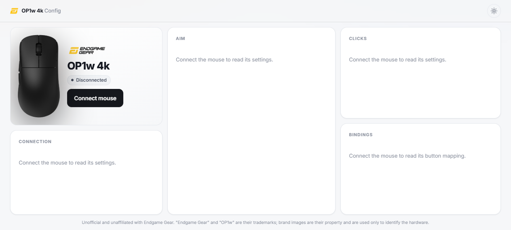
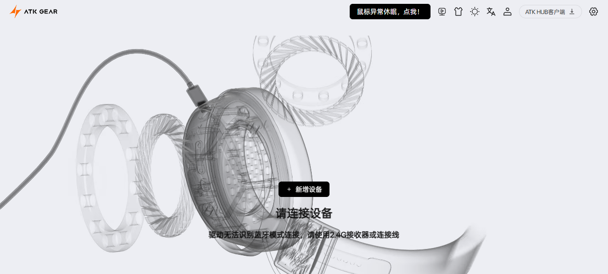

# UI 参考与移植可行性（2026-10-09）

> 用户提供两个参考站：`https://op1w.vercel.app/`（zexsso/OP1-WebAPP，MIT，**同一台设备 OP1w 4k**）
> 与 `https://hub.atk.pro/`（ATK HUB，闭源商业驱动站）。
> 本文是实测对照 + 移植方案 + GitHub Pages 部署可行性。
> 原始素材：`re/upstream/SOURCES.md` 的「UI 参考」一节（设计令牌、组件清单已存档）。

---

## 一、op1w.vercel.app —— 最直接的对标（同一台鼠标）

**技术**：Vue 3 + Vite + Tailwind v4，代码分割。主包 105 KB + 设备视图分包 32 KB + CSS 29 KB
≈ 166 KB（另挂 Inter 字体）。产物 HTML 是空的 `
` 壳。

**设计令牌**（深浅两套完整定义，均已在 `[data-theme]` 块内）：

| 组 | 值 |
|---|---|
| 强调色 | 默认紫 `#8b7cff`，**品牌皮肤覆盖为 EGG 橙 `#ff5c00`**（accent-2 `#ff8340`） |
| 面 | bg `#08090b` / surface `#101216` / surface-2 `#171a20` / surface-3 `#20242c` |
| 文字 | text `#f2f4f8` / text-2 `#aeb4c0` / text-3 `#727885` |
| 语义 | ok `#4ade80` · warn `#fbbf24` · err `#f87171`，**各带 `-bg` / `-border` 透明变体** |
| 边框 | border / border-**strong** 两级 |
| 圆角 | `--r-sm/md/lg/full` = 8 / 11 / 16 / 999 px |
| 动效 | `--dur-1/2` = .14 / .26 s + 自定义缓动 `cubic-bezier(.22,1,.36,1)`（自称 organic） |
| 其它 | glass / ring / overlay / 三级阴影（sm/md/lg） |

**布局**：顶栏（品牌标 + 字标 + 主题切换）→ **bento 网格**：
产品图 hero 卡（型号 + `● Disconnected` + 黑色主按钮 `Connect mouse`）、`AIM`、`CLICKS`、
`CONNECTION`、`BINDINGS`。小节标题是**大写 + 字距的微型标签**；每一格的空态统一一句话
`Connect the mouse to read its settings.`；页脚一行商标声明。

> *（2026-10-09 无头浏览器实拍；浅色主题为浏览器/system 偏好，页面自身深色令牌见下表。）*

**两项值得我们学的交互**：

1. **接口打分选优** —— `score(device)` 遍历 collections，按 feature report 是否含
   `0xA1` / `0xA0` 与 usagePage 是否为 `0xFF01` 累加分数，`requestDevice` 返回多个时**自动挑最高分**。
   （我们是用「精确 filter + `isSafeToOpen()` 闸门 + 优先级列表」：更保守、更安全，
   但代价是一旦选错接口要用户自己重选。）
2. **无选择器重连** —— `tryReconnect()` 直接 `getDevices()` 取回已授权设备并重新 `open()`，
   刷新页面后不必再点一次选择器。**这条我们确实缺，而且不涉及协议，值得补。**

**设备表**：`3367:1970`(dongle) / `3367:1972`(wired) / `3367:1971`(wired alt) / `22D4:1503`(legacy)，
每项带 `gen` 与 `wired` 字段。功能面：DPI / 回报率 / LOD / 去抖 / 灯效；**无宏、无配置档**。

---

## 二、hub.atk.pro —— 商业级 hub，不在同一量级

**技术**：Vue + Vite（资产版本 `3.2.27`，走 CDN `bpcdn.atkgear.com`）。
体量 **5.8 MB JS + 675 KB CSS + 2.1 MB 语言包 ≈ 8.5 MB+**；百度统计；`gif.js` + `gifToCanvas`
做动效背景。

**版式**：浅灰底（`#EDEEF3`）+ **巨型爆炸渲染图 hero**；居中「请连接设备」+ 蓝牙提示；
深色胶囊按钮「鼠标异常休眠，点我！」；右上角一排幽灵图标（下载客户端 / 主题 / 信号 / 分享 / 账号）
+「ATK HUB 客户端 ↓」；还有一张可关闭的电商推荐卡。

> *（2026-10-09 无头浏览器实拍。整块 UI 都在「连接设备」之后，未接设备时只能看到这一屏。）*

**覆盖面**：鼠标 + 键盘 + 耳机 + 接收器，≥7 个 vendorId（`0x373B` / `0x3554` / `0x1A81` /
`0x0C45`(Sonix) / `0x413D` / `0x0666` / `0x320F`），含**固件升级**。
自有字体 `OppoSans4` / `HarmonyOS Sans SC` / `DIN` / `Fira Code`。

**结论**：它是「桌面客户端 + 网页 hub」双形态的营销+配置门面，8.5 MB 与整站动效不是我们该追的方向；
**可借的只有一条：首屏要大、要说人话**（他们的空态就是一句话 + 一个动作）。

---

## 三、我们现在的样子（诚实评估）

**事实**：单文件 **253 KB（磁盘字节；此前构建日志按 UTF-16 `.length` 报成 207 KB，已修）**、
8 语言 219 键、深浅主题、四代协议覆盖、写入闸门 + 回读校验、离线 blob 工具。

**差距排序**（从最影响观感开始）：

1. **首屏没有"这是什么、我该干什么"的视觉引导** —— 他们都有 hero + 大按钮，我们只有一条横幅；
   未连接时用户看到的是「设备信息：全 —」的表格。
2. **信息架构**：我们把两组设置平铺成长表单（表格 + 成排的 label/select）；
   他们按 `AIM` / `CLICKS` / `BINDINGS` 分块，每块空态只说一句。
3. **视觉系统**：我们**有令牌**（`_tokens.scss` 已转发为 CSS 变量）但没有**尺度**——
   圆角/阴影/动效/大写字距标签/字号级差都不成节奏。
4. **品牌感**：他们靠产品图 + 标志 + 强调色贯穿；我们只有一个 `🖱️`。

---

## 四、方案 A（推荐）：保留单文件，只换视觉体系

**范围**：只动 `scss/` 与 `index.template.html`，**不碰任何协议、闸门、写路径代码**。

1. 令牌对齐：采用同样的**语义命名**（surface / text-2 / ok-bg / r-md / dur-2 / ease），
   直接落到 `_tokens.scss` + `:root` / `[data-theme="dark"]`（现有机制不变）。
   ⚠️ 许可：OP1-WebAPP 是 **MIT**，并入 GPL-3 项目合法，但要在致谢区标注出处（已致谢）。
2. 组件壳：`PageHeader` / `Card` / `MicroLabel`（大写小标签）/ `EmptyState` /
   `SegmentedControl` / `Switch` / `Badge`——用现有 SCSS 变量实现，不引框架。
3. 内容重排：hero 卡（型号 + 连接状态 + 连接按钮）→ `AIM` → `PERFORMANCE` → `CLICKS` → `TOOLS`。
4. 空态统一成一句话；**保留**我们的「这些设置是什么意思？」与预设——这是官方和他们都**没有**的差异点。
5. ⚠️ **不能照搬的**：产品渲染图 / 商标图片是 EGG 的资产，**不进我们的仓库**
   （他们用免责声明兜着；我们改自绘 SVG 剪影）。

**代价**：模板改动大 → `re/layout_check.py`（卡片/行可见性）与 `re/render_check.py`（逐语言溢出）
必须跟着改；预计两次提交（令牌+外壳 → 内容重排）。

---

## 五、方案 B（不建议）：迁到 Vue 3 + Tailwind

能最快拿到同款观感（直接复用他们的组件与 Tailwind 配置），但代价是：

- **放弃"单文件零依赖"这个核心卖点** —— 产物变成 HTML + 多个哈希命名 js/css；
- 构建链从 `esbuild + sass` 换成 Vite，8 语言词条、协议测试、布局回归全要适配；
- **GitHub Pages 还必须把 Vite `base` 改成 `'./'`**（默认 `'/'` 在项目页子路径会 404）。

结论：除非我们要转成常规 Web 应用形态，否则不值。

---

## 六、部署到 GitHub Pages：可行性（已实测）

### 已核实可行的部分

| 项 | 实测结果 |
|---|---|
| 绝对路径 | **0 处**（`href/src="/…"`），也没有 `<base>` 标签 → 项目页 `/repo/` 子路径不会破 |
| 外部依赖 | 无（只有致谢区的文本外链）→ 不依赖 CDN、不受跨域影响 |
| 子路径服务 | 本地以 `http://127.0.0.1:8099/repo/`（模拟项目页）服务，主页面与 `tools/blob-studio.html` 与产物**逐字节一致**（253 KB / 15 KB） |
| 安全上下文 | Pages 是 HTTPS → 满足 WebHID；`hid` 权限策略默认 allowlist 是 `self`，而我们的页面**始终是顶层文档**（只有被别人 iframe 嵌入时才需要 `allow="hid"`） |
| 体积 | 单文件 253 KB ≪ 100 MB/文件、1 GB/站点 |

### 三个必须处理的坑（已修前两个）

1. **`.nojekyll`**（已加）：分支发布默认跑 Jekyll —— 它会排除 `_` 开头的文件（我们的 `scss/_tokens.scss`
   等），更糟的是**一旦 Jekyll 构建失败，整站 404**。仓库只需要托管两个构建好的 HTML。
2. **`tools/blob-studio.html` 在页面上没有入口**（已加链接）：README 写了路径，但 Pages 访客点不到。
3. **缓存 10 分钟**：Pages 给静态资源 `Cache-Control: max-age=600`，推送后旧版本可能还挂着——
   验证时硬刷新（Ctrl+F5）或换个路径。

**另注**：从仓库根发布会把**整个仓库**公开托管（含 `src/`、`re/` 的逆向笔记）。
已确认没有厂商二进制入库（`.gitignore` 覆盖 `*.exe` 与真机 blob），所以只是"公开源码"，
不是"分发他人软件"。若要只公开产物，更干净的做法是单独一个 `gh-pages` 分支只放那两个 HTML。

**对照**：op1w 站用的是 `/assets/index-*.js`、`/brand/eg-mark.png` **绝对路径** ——
在 Vercel 根域没问题，但同一份构建搬到 `user.github.io/repo/` 会 **404**。
我们单文件反而没有这个陷阱。

---

## 七、建议顺序

1. ✅ Pages 三个坑（`.nojekyll` / 工具页入口 / 构建体积如实上报）
2. ☐ **方案 A 第一步**：令牌 + 顶栏 + 卡片外壳 + 统一空态（不动表单内部，风险最低）
3. ☐ 方案 A 第二步：内容分块重排 + hero 卡 + 自绘 SVG 剪影
4. ☐ 可选增强：**无选择器重连**（`getDevices()` 重挂已授权设备）—— 体验明显更好，且不碰协议
